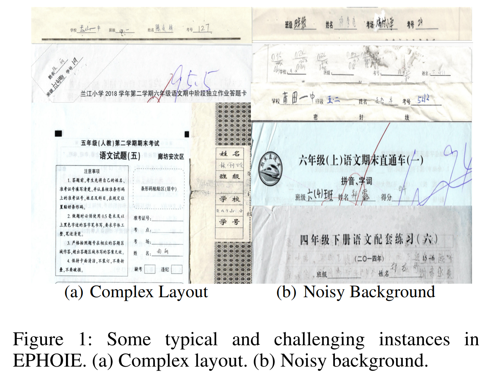
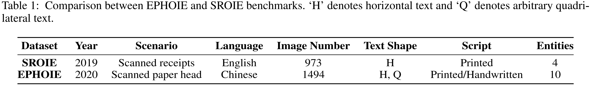
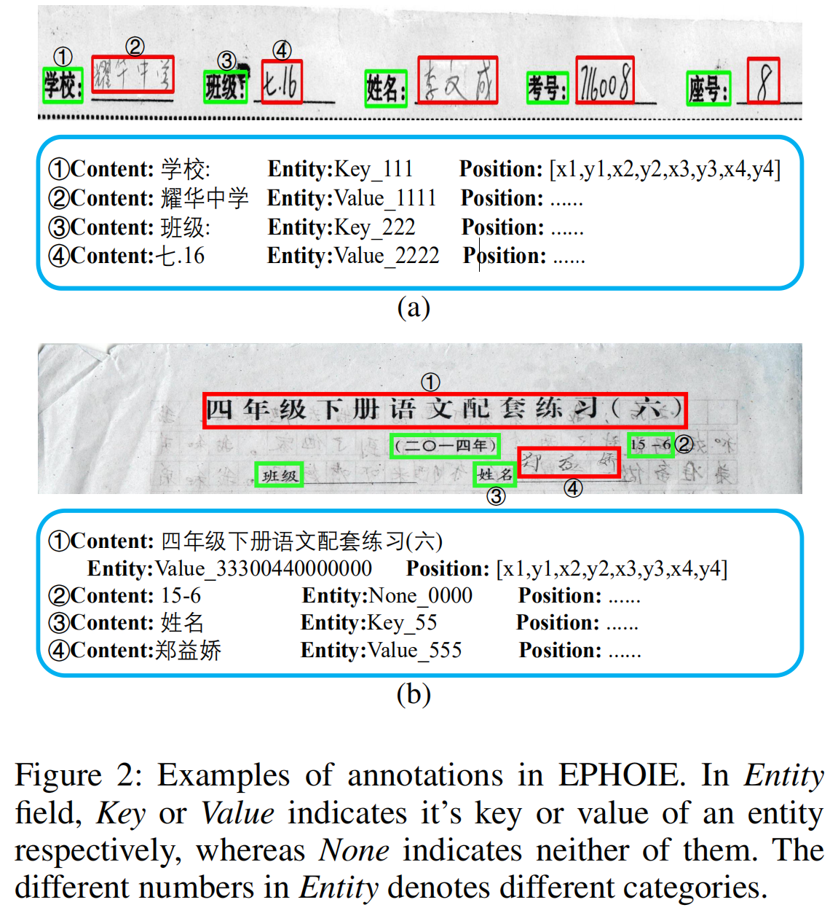

# EPHOIE_Dataset_Release [[Paper Link](https://arxiv.org/abs/2102.06732)]

The EPHOIE Dataset for the research of **optical character recognition (OCR)** and **visual information extraction (VIE)** in educational documents is now released by Deep Leaning and Visual Computing (DLVC) Lab of South China University of Technology. The dataset can be downloaded through the following link:

- [OneDrive](https://1drv.ms/u/s!Ahd-h7H5akVZcM97rDSpAGTIgz4?e=dgLl5C) 

The SCUT-EnsText dataset can only be used for **non-commercial research purpose**. Trainging set and testing set are available now, but the training set is encrypted with additional code. To request access, please follow these steps:

**Step 1: Download and complete the agreement document:**

- [Application Form for Using EPHOIE](https://github.com/HCIILAB/EPHOIE/blob/main/Application_Form_for_Using_EPHOIE_2021.doc)

Have this document signed and stamped by your institution. Please also prepare 1–2 recent publications (within the last 6 years) as evidence that you or your team conduct research in OCR, handwriting analysis and recognition, document image processing, visual information extraction.

**Step 2: Submit your application online:**

> 🔗 **[SCUT DLVC Lab Dataset Access Portal → Apply for EPHOIE](http://121.41.49.212:9000/apply/ephoie)**

Upload both signed documents through the portal and fill out the "Recent Publications" block. Your application will be reviewed manually and you will be notified by email once a decision has been made (typically within 1–5 business days).

**Step 3: Download the dataset:**

After approval, you will receive the download link and decompression password via email.

> ⚠️ All users must comply with the use conditions at all times; failure to do so will result in revocation of access.

For any person/institute/company who do not works in the field of OCR or document analysis and visual information extraction, please contact us to obtain a commercial license. 

## Description

The EPHOIE Dataset contains 1,494 images which are collected and scanned from real examination papers of various schools in China, and we crop the paper head regions which contains all key information. The texts are composed of handwritten and printed Chinese characters in horizontal and arbitrary quadrilateral shape. Complex layouts and noisy background also enhance the generalization of EPHOIE dataset. Typical examples are shown in Figure 1.



To the best of our knowledge, the EPHOIE benchmark is the first public dataset for both OCR and VIE tasks in Chinese and aims to motivate more advanced works in the fields of both document intelligence and VIE. It is divided into a training set with 1,183 images and a testing set with 311 images respectively. All the images in EPHOIE are collected and scanned from real examination papers of various schools with the diversity of text types and layout distribution. For privacy protection, we erase and re-synthesize some specific fields like names and schools. The statistic of our dataset and the comparison with the most widely used public benchmark SROIE are shown in Table 1.



The detailed annotation forms of EPHOIE are presented in Figure 2. As there exist both horizontal and arbitrary quadrilateral texts, four vertices were required to surround them. In addition to annotating bounding boxes for text detection, text content is also required for both text recognition and information extraction. We annotate all the texts appearing on the image, while additionally label the entity key-value pair for all key information. The number string in Entity denotes the category of each token, since there may exists multiple entities in a single segment.



## Citation and Contact
Please consider to cite [our paper](https://arxiv.org/abs/2102.06732) when you use our dataset:
```
@inproceedings{wang2021vies,
  title={Towards Robust Visual Information Extraction in Real World: New Dataset and Novel Solution},
  author={Wang, Jiapeng and Liu, Chongyu and Jin, Lianwen and Tang, Guozhi and Zhang, Jiaxin and Zhang, Shuaitao and Wang, Qianying and Wu, Yaqiang and Cai, Mingxiang},
  booktitle={Proceedings of the AAAI Conference on Artificial Intelligence},
  year={2021}
}
```
For any quetions about the dataset please contact Prof. Jin([eelwjin@scut.edu.cn](mailto:eelwjin@scut.edu.cn)).


